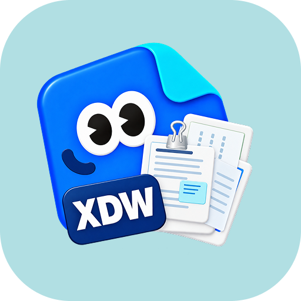
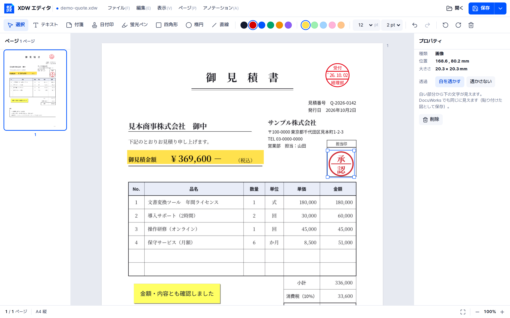

<p align="center">
  
</p>
<h1 align="center">EZPZ File XDW</h1>
<p align="center"><a href="README.md">日本語</a> · <b>English</b> · <a href="README.ko.md">한국어</a></p>
<p align="center">
  <a href="https://ezpzfile.com/xdw-editor"></a>
</p>
<p align="center"><sub>Demo: <a href="https://ezpzfile.com/xdw-editor">English</a> · <a href="https://ezpzfile.com/ja/xdw-editor">日本語</a></sub></p>

**Open, annotate and save DocuWorks (`.xdw`) documents anywhere: Mac, Linux, phone, browser.**
An open-source engine, editor and format specification for FUJIFILM (Fuji Xerox)
DocuWorks files, built from scratch. Files never leave your device.

Status: **v0.3, viewer + editor that saves back to `.xdw` / `.xbd` (developer preview).**
Not affiliated with FUJIFILM Business Innovation.

[](https://ezpzfile.com/xdw-editor)

<sub>A sample quotation with a date stamp, highlighter, sticky note and a see-through approval seal. It looks the same in DocuWorks.</sub>

## Use it in your browser (no install)

We run free tools built directly on this engine. Your files never leave your device.

- [XDW editor](https://ezpzfile.com/xdw-editor): open a .xdw or .xbd, add sticky notes and date stamps, and save it as it was. Converts to PDF too
- [How to open a .xdw file without DocuWorks](https://ezpzfile.com/column/open-xdw-file)

### Sites using this engine

- [openedfile.com](https://openedfile.com/ja/tools/xdw): a tool to open .xdw files in the browser and convert them to PDF

Using it somewhere? Let us know and we will add you here.

## What works

Tested on 43 public DocuWorks files (generation 7 and 10, `.xdw` and `.xbd`):

- all 43 open, every page draws with no unknown drawing records
- pages: EMF and WMF drawings, the DocuWorks driver's own compact path and
  picture records, JPEG picture strips, scanned/rotated pages, annotations
- **saving back to `.xdw`**: the whole file is written anew with only what the
  document uses now, so deleted pages and annotations do not stay in the file.
  A signed document is saved the way DocuWorks saves (one segment appended), which
  keeps the signed state. Saved files open in **DocuWorks Viewer Light**
- **new documents**: start from a blank A4 page, written the way DocuWorks 10 writes
  a new document. Drop PDFs or pictures with nothing open and their pages make a
  new document
- annotations: add **text, sticky note (付箋), date stamp (日付印), highlighter,
  rectangle, ellipse, line, picture**; move, resize, change, delete (existing
  annotations from DocuWorks too: move / delete). A picture can be
  **see-through**: its white parts show the text underneath, in DocuWorks too
- **select and copy text** in pages, **search** the document (Ctrl+F)
- pages: turn left / right, delete, reorder (drag in the page list);
  **insert** a blank page, pictures (JPEG / PNG / …), pages of another `.xdw` /
  `.xbd`, or PDF pages (as pictures, with the PDF's text kept under the picture so it can be
  searched and copied; needs the network once for pdf.js)
- **binders (`.xbd`)**: documents shown in the page list; add `.xdw` files,
  rename, reorder, remove documents
- export: **PDF** (looks like the screen, text searchable/copyable), plain text; print
- **covered text stays covered**: text blacked out with a rectangle annotation or an opaque
  picture is left out of the extracted text and of the PDF text layer, so what looks redacted
  does not come back by copying or searching. The editor says how many characters it left out
  when saving. `includeHidden` keeps them
- **safe with untrusted files**: sizes and counts written in a file are not trusted; a file past
  the limits stops with "too large or damaged". In the browser a file is checked in a Web Worker
  before it opens (see "Opening untrusted files")
- undo / redo

The format findings, including the check value DocuWorks verifies and the
driver's private drawing records, are in [docs/spec/XDW-FORMAT.md](docs/spec/XDW-FORMAT.md).

Signed documents open, and selecting a signature shows its information (an
electronic seal or a certificate, the signing module, the version). Editing
voids the signature, and the editor says so.

Documents protected by a password or a certificate are reported as protected,
with a note to remove the protection in DocuWorks first (this editor never
handles passwords).

Not yet: verifying that a signature still holds, and adding signatures or
passwords. See the [plan](docs/PLAN.en.md)
([日本語](docs/PLAN.ja.md), [한국어](docs/PLAN.ko.md)).

## Opening untrusted files

A `.xdw` carries its own sizes: how large compressed data becomes, how many pixels a picture has,
how many points a line has. A crafted file can claim far more than it holds (a few hundred bytes
that say "4 GB once expanded"), so the engine checks every count against the data that is really
there and stops at these limits. The defaults are far above what real documents need (the largest
values in the public samples stay under 30% of every limit).

| Limit | Default | What it counts |
|---|---|---|
| `maxBytes` | 768 MB | working memory for opening the document, or for drawing one page (expanded data and pictures) |
| `maxExpand` | 256 MB | one compressed block, expanded |
| `maxRatio` | 1000 × | one compressed block: expanded size over stored size |
| `maxPages` | 20,000 | pages in the document |
| `maxImagePixels` | 100 million | pixels in one picture |
| `maxRecords` | 1 million | drawing records on one page |
| `maxPoints` | 5 million | line points and characters on one page |

Past a limit the call fails with "too large or damaged: …". When you embed the engine in another
service, lower the limits and run it in a Web Worker. `web/worker/ezpzxdw-safe.js` does that for you
and terminates the worker on a timeout. The browser engine uses at most 1 GiB of memory.

```js
import { readXdwSafely } from "./worker/ezpzxdw-safe.js";
const { result, hiddenChars } = await readXdwSafely(bytes, { want: "text", limits: { maxPages: 300 }, timeoutMs: 15000 });
// or directly: XdwDoc.openWith(bytes, '{"maxPages":300}')
```

In Rust: `Document::open_with(bytes, &Limits { max_pages: 300, ..Default::default() })`.

Covered text: a character is left out when the inner part of its box (inside its advance, from the
baseline up to 0.7 em) lies completely inside an opaque fill (white too) or an opaque picture drawn
after it, within that one's clip. A highlighter (multiplying), a partly transparent picture and a line
are not covers. A picture in the same drawing as the text is not a cover either: scanned pages with
recognised text and pages taken from a PDF keep their text under the picture. To keep covered text:
`XdwDoc.setIncludeHidden(true)`, in Rust `doc.include_hidden = true`, on the command line
`ezpzxdw text file.xdw --include-hidden`. A file saved as `.xdw` still holds the covered text, as in
DocuWorks; to hand over a redacted document, save it as PDF.

## Editor

`web/dist/ezpzxdw-editor.html` is the whole editor in one file: double-click it,
drop a `.xdw` on the window, annotate, and save (Ctrl+S → `.xdw`). The screen
follows DocuWorks Viewer (page list on the left, annotation tools on top,
properties on the right) in the EZPZ File design. Keys: T text, S sticky note,
D date stamp, H highlighter, R rectangle, E ellipse, L line, Esc select,
Delete, arrows (Shift = 1 cm), Ctrl+Z / Ctrl+Y, Ctrl+S, Ctrl+Shift+S (save as
PDF / text), Ctrl+P, Ctrl+F (search). Drop a PDF or a picture on an open document to insert it
as pages; with nothing open, it becomes a new document.

The screen comes in Japanese and English: `web/dist/ezpzxdw-editor.en.html` is the
English one, and `?lang=en` / `?lang=ja` switches either file. To use it right away in a
browser: [ezpzfile.com/xdw-editor](https://ezpzfile.com/xdw-editor). To put it on a site,
use `web/dist/ezpzxdw-editor.embed.html` with the URL of the `.wasm` from `web/pkg/`
filled in. Opened in a frame of a page on the same site, it talks to that page as
`web/editor/host.js` describes.

## Checked against the real DocuWorks

`tools/dwview` runs FUJIFILM's free DocuWorks Viewer Light under Wine and reports
whether a file opens, with a screenshot. `tools/dwapi` calls the API of
the latest DocuWorks 10 itself so that DocuWorks reads our saved
files (pages, annotations and their settings) and draws their pages. Every
saved test file matches and draws (38 public samples + 5 DocuWorks 10 samples,
all editing features); DocuWorks Desk lists them with their pages. New documents
made from scratch and files written anew open in Viewer Light too (39 public samples
rewritten and edited, new documents, files saved from the browser). See
[experiments/results.md](experiments/results.md) (in Korean).

## Layout

```
engine/crates/ezpzxdw-core   reader, renderer (EMF/WMF/DW → display list), editor, writer, PDF
engine/crates/ezpzxdw-cli    `ezpzxdw` command: info, tree, pages, render, text, edit, check …
engine/crates/ezpzxdw-wasm   browser bindings
web/                       the editor (build: web/build.sh → web/dist/ezpzxdw-editor.html)
web/worker/                read untrusted files in a Web Worker (ezpzxdw-safe.js)
docs/spec/XDW-FORMAT.md    the format
docs/PLAN.{ja,en,ko}.md    plan and progress (日本語, English, 한국어)
tools/dwview               DocuWorks Viewer Light as a referee (Wine)
tools/dwapi                DocuWorks 10 itself, through its API, as a referee (Wine)
tools/webshot              the editor driven headless (Playwright)
corpus/manifest.tsv        where the public sample files come from (files not included)
```

## Build

```
cd engine && cargo test                       # + EZPZXDW_CORPUS=/path/to/samples for the corpus tests
cargo run -p ezpzxdw-cli -- pages file.xdw
web/build.sh                                  # needs wasm32 target and wasm-bindgen-cli 0.2.129
```

## License

MIT License ([LICENSE](LICENSE)). You may use, change, share and sell it freely. Keep the copyright notice
"Copyright (c) 2026 EZPZ File (https://ezpzfile.com)" and the licence text in copies and changed versions.
If you use it in a service or product, a "Powered by EZPZ File" credit somewhere would be appreciated (optional).
See [NOTICE](NOTICE) for trademarks and third-party assets.
