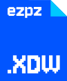
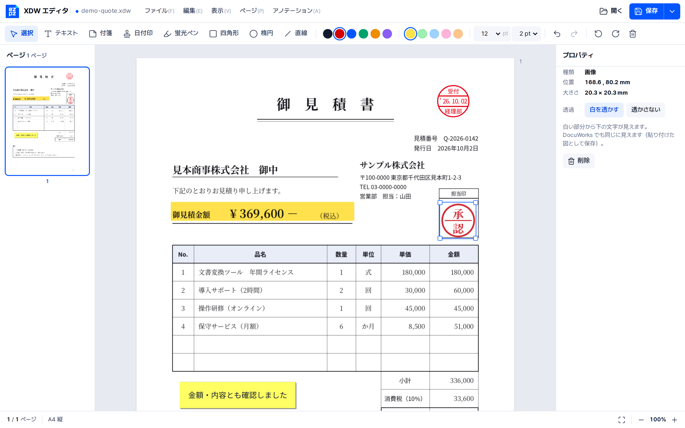

<p align="center">
  
</p>
<h1 align="center">EZPZ File XDW</h1>
<p align="center"><a href="README.md">日本語</a> · <a href="README.en.md">English</a> · <b>한국어</b></p>
<p align="center">
  <a href="https://ezpzfile.com/ja/xdw-editor"></a>
</p>
<p align="center"><sub>데모: <a href="https://ezpzfile.com/ja/xdw-editor">日本語</a> · <a href="https://ezpzfile.com/xdw-editor">English</a></sub></p>

**DocuWorks(`.xdw`) 문서를 맥·리눅스·휴대폰·브라우저에서 열고 주석을 달아 그대로 저장.**
후지필름(옛 후지제록스) DocuWorks 파일을 다루는 오픈소스 엔진·편집기·파일 형식 규격서입니다.
처음부터 새로 만들었고 파일은 기기 밖으로 보내지 않습니다.

상태: **v0.3. `.xdw` / `.xbd`로 다시 저장하는 뷰어 + 편집기(개발자 미리보기).**
후지필름 비즈니스 이노베이션과는 관계없습니다.

[](https://ezpzfile.com/ja/xdw-editor)

<sub>견본 견적서에 날짜 도장·형광펜·付箋·비치는 승인 도장을 단 모습. DocuWorks에서 열어도 똑같이 보입니다.</sub>

## 되는 것

인터넷에 공개된 DocuWorks 파일 43개(세대 7·10, `.xdw`와 `.xbd`)로 확인했습니다.

- 43개 모두 열리고 모든 쪽이 모르는 그리기 기록 없이 그려짐
- 쪽: EMF·WMF 그림, DocuWorks 드라이버 전용 압축 경로·그림 기록, JPEG 그림 조각, 스캔·회전된 쪽, 주석
- **`.xdw`로 저장**: 파일 전체를 새로 써서 지금 쓰는 데이터만 남김(지운 쪽이나 주석이 파일에 남지 않음).
  서명이 있는 문서만 DocuWorks와 같은 방식(끝에 세그먼트 하나를 덧붙임)으로 저장해 서명한 때의 내용을 남김.
  저장한 파일은 **DocuWorks Viewer Light**에서 열림
- **새 문서**: 빈 A4 한 쪽으로 새 DocuWorks 문서를 만듦(DocuWorks 10이 만드는 문서와 같은 모양). 아무것도 열지
  않은 채 PDF나 그림을 끌어다 놓으면 그 쪽들로 새 문서가 됨
- 주석: **텍스트, 付箋(포스트잇), 日付印(날짜 도장), 형광펜, 사각형, 타원, 직선, 그림** 추가. 이동·크기·
  내용 변경·삭제(DocuWorks에서 단 기존 주석도 이동·삭제 가능). 그림은 **흰 부분을 비치게** 해서 밑의 글자가
  보이게 할 수 있고, DocuWorks에서도 똑같이 보임
- 쪽 안 **글자 선택·복사**, **문서 안 찾기**(Ctrl+F)
- 쪽: 왼쪽·오른쪽 회전, 삭제, 순서 바꾸기(쪽 목록에서 끌기). 빈 쪽, 그림(JPEG / PNG 등), 다른 `.xdw` /
  `.xbd`의 쪽, PDF 쪽(그림으로. PDF의 글자도 그림 밑에 남아 찾기·복사 가능. pdf.js 때문에 처음 한 번은 인터넷 필요) **넣기**
- **바인더(`.xbd`)**: 쪽 목록에 문서별로 표시. `.xdw` 추가, 이름 바꾸기, 순서 바꾸기, 빼기
- 내보내기: **PDF**(화면과 같은 모양, 글자 검색·복사 가능), 텍스트. 인쇄
- **가린 글자는 남기지 않음**: 검은 사각형 주석이나 불투명한 그림으로 가린 글자는 뽑은 텍스트에도 PDF 글자 층에도
  넣지 않음(보이는 대로 가린 부분이 복사나 찾기로 되살아나지 않음). 편집기는 저장할 때 몇 글자를 뺐는지 알려 줌.
  남기려면 `includeHidden`
- **믿을 수 없는 파일 대비**: 파일에 적힌 크기와 개수를 그대로 믿지 않고, 상한을 넘는 파일은 "too large or damaged
  (너무 크거나 깨짐)"로 멈춤. 브라우저에서는 Web Worker 안에서 확인한 뒤 엶(아래 "믿을 수 없는 파일 열기")
- 되돌리기 / 다시 하기

DocuWorks가 확인하는 검사값, 드라이버 전용 그리기 기록 등 파일 형식 분석 결과는
[docs/spec/XDW-FORMAT.md](docs/spec/XDW-FORMAT.md)(영어)에 있습니다.

서명된 문서는 열리고, 서명을 고르면 그 정보(전자 도장인지 인증서인지, 서명 모듈, 버전)가 나옵니다.
편집하면 서명이 무효가 되므로 편집기가 알려 줍니다.

암호나 전자 인증서로 보호된 문서는 "보호된 문서"로 알려 주고, DocuWorks에서 보안을 푼 뒤 열라고 안내합니다
(이 편집기는 암호를 다루지 않습니다).

아직 안 되는 것: 서명이 지금도 유효한지 확인, 새 서명·암호 달기.
자세한 내용은 [계획](docs/PLAN.ko.md)
([日本語](docs/PLAN.ja.md), [English](docs/PLAN.en.md)).

## 믿을 수 없는 파일 열기

`.xdw`는 압축 데이터를 풀었을 때의 크기, 그림의 화소 수, 선의 점 개수 등을 스스로 적어 둡니다. 조작한 파일은
실제 내용보다 훨씬 큰 수를 적을 수 있어서(몇백 바이트로 "풀면 4 GB" 등), 엔진은 그 수를 그대로 믿지 않고 실제로
있는 데이터와 맞춰 보며 아래 상한에서 멈춥니다. 기본값은 실제 문서에 필요한 양보다 훨씬 큽니다(공개 견본의 가장 큰
값도 모든 상한의 30% 이하).

| 상한 | 기본값 | 세는 것 |
|---|---|---|
| `maxBytes` | 768 MB | 문서 한 번 열기, 또는 한 쪽 그리기에 쓰는 작업 메모리(푼 데이터와 그림의 합) |
| `maxExpand` | 256 MB | 압축 데이터 하나를 푼 크기 |
| `maxRatio` | 1000배 | 압축 데이터 하나의 푼 크기 대 저장 크기 |
| `maxPages` | 20,000 | 문서의 쪽 수 |
| `maxImagePixels` | 1억 | 그림 하나의 화소 수 |
| `maxRecords` | 100만 | 한 쪽의 그리기 기록 수 |
| `maxPoints` | 500만 | 한 쪽의 선 점과 글자 수 |

넘으면 "too large or damaged: …" 오류가 납니다. 다른 서비스에 넣을 때는 상한을 낮추고 Web Worker 안에서 돌리세요.
`web/worker/ezpzxdw-safe.js`가 그렇게 해 주고, 시간을 넘긴 Worker는 멈춥니다. 브라우저용 엔진은 메모리를 최대
1 GiB까지만 씁니다.

```js
import { readXdwSafely } from "./worker/ezpzxdw-safe.js";
const { result, hiddenChars } = await readXdwSafely(bytes, { want: "text", limits: { maxPages: 300 }, timeoutMs: 15000 });
// 직접: XdwDoc.openWith(bytes, '{"maxPages":300}')
```

Rust에서는 `Document::open_with(bytes, &Limits { max_pages: 300, ..Default::default() })`.

가린 글자: 글자의 틀(보내기 폭 안쪽, 기준선에서 0.7 em 위까지)이 나중에 그려진 불투명한 칠(흰색 포함)이나 불투명한
그림 안에, 그 클립 범위까지 포함해 완전히 들어가면 뺍니다. 형광펜(곱하기), 반투명한 그림, 선은 가리개로 보지 않습니다.
글자와 같은 그림 안의 그림도 가리개로 보지 않습니다(문자 인식한 스캔이나 PDF에서 가져온 쪽은 글자를 그림 밑에 두기
때문). 남기려면 `XdwDoc.setIncludeHidden(true)`, Rust에서는 `doc.include_hidden = true`, 명령에서는
`ezpzxdw text file.xdw --include-hidden`.
`.xdw`로 저장한 파일에는 DocuWorks와 같이 가린 글자도 그대로 남습니다. 가린 문서를 건넬 때는 PDF로 저장하세요.

## 편집기

`web/dist/ezpzxdw-editor.html` 한 파일이 편집기 전체입니다. 더블클릭해서 열고 `.xdw`를 창에 끌어다 놓고
주석을 단 뒤 저장합니다(Ctrl+S → `.xdw`). 화면 배치는 DocuWorks Viewer와 같고(왼쪽 쪽 목록, 위 주석 도구,
오른쪽 속성), 모양은 EZPZ File 디자인입니다.

키: T 텍스트, S 付箋, D 日付印, H 형광펜, R 사각형, E 타원, L 직선, Esc 선택, Delete 삭제,
화살표(Shift는 1cm), Ctrl+Z / Ctrl+Y, Ctrl+S, Ctrl+Shift+S(PDF·텍스트로 저장), Ctrl+P, Ctrl+F(찾기).
열린 문서에 PDF나 그림을 끌어다 놓으면 쪽으로 들어가고, 아무것도 열지 않았으면 그것으로 새 문서를 만듭니다.

화면 글은 일본어와 영어가 있습니다. 영어판은 `web/dist/ezpzxdw-editor.en.html`이고, 어느 파일이든
`?lang=en` / `?lang=ja`로 바꿀 수 있습니다. 브라우저에서 바로 쓰려면 [ezpzfile.com/xdw-editor](https://ezpzfile.com/xdw-editor).
다른 사이트에 올릴 때는 `web/dist/ezpzxdw-editor.embed.html`에 `web/pkg/`의 `.wasm` 주소를 넣어 씁니다.
같은 사이트의 틀(iframe) 안에서 열리면 `web/editor/host.js`에 적힌 약속대로 그 쪽과 말을 주고받습니다.

## 진짜 DocuWorks로 확인

`tools/dwview`는 후지필름의 무료 뷰어 DocuWorks Viewer Light를 Wine에서 돌려, 파일이 열리는지 화면
사진과 함께 알려 줍니다. `tools/dwapi`는 DocuWorks 10 본체(최신판)의 API를 불러, 우리가 저장한
파일을 DocuWorks가 직접 읽고(쪽, 주석과 그 설정) 쪽을 그리게 합니다. 테스트로 저장한 파일은 모두
일치하고 그려졌습니다(공개 샘플 38개 + DocuWorks 10 샘플 5개, 모든 편집 기능). DocuWorks Desk 목록에도
쪽과 함께 나옵니다. 처음부터 만든 새 문서와 파일 전체를 새로 쓴 저장도 Viewer Light에서 열리는 것을
확인했습니다(공개 샘플 39개를 새로 쓴 것과 고쳐 저장한 것, 새 문서, 브라우저에서 저장한 것). 결과는
[experiments/results.md](experiments/results.md)에 있습니다.

## 구성

```
engine/crates/ezpzxdw-core   읽기, 그리기(EMF/WMF/DW → 표시 목록), 편집, 저장, PDF
engine/crates/ezpzxdw-cli    `ezpzxdw` 명령: info, tree, pages, render, text, edit, check …
engine/crates/ezpzxdw-wasm   브라우저용 연결
web/                       편집기(빌드: web/build.sh → web/dist/ezpzxdw-editor.html)
web/worker/                믿을 수 없는 파일을 Web Worker에서 읽기 (ezpzxdw-safe.js)
docs/spec/XDW-FORMAT.md    파일 형식(영어)
docs/PLAN.{ja,en,ko}.md    계획과 진행 상황(日本語, English, 한국어)
tools/dwview               DocuWorks Viewer Light를 심판으로(Wine)
tools/dwapi                DocuWorks 10 본체를 API로 심판으로(Wine)
tools/webshot              화면 없이 편집기 조작(Playwright)
corpus/manifest.tsv        공개 샘플 파일 출처(파일 자체는 없음)
```

## 빌드

```
cd engine && cargo test                       # 코퍼스 테스트는 EZPZXDW_CORPUS=/path/to/samples 추가
cargo run -p ezpzxdw-cli -- pages file.xdw
web/build.sh                                  # wasm32 타깃과 wasm-bindgen-cli 0.2.129 필요
```

## 라이선스

MIT 라이선스([LICENSE](LICENSE)). 쓰기·고치기·다시 배포·상업적 이용 모두 자유입니다. 복사본이나 고친 판에는
저작권 표시 "Copyright (c) 2026 EZPZ File (https://ezpzfile.com)" 한 줄과 라이선스 글을 그대로 남겨 주세요.
서비스나 제품에 쓸 때 어딘가에 "Powered by EZPZ File"라고 표시해 주시면 고맙겠습니다(선택).
상표와 외부 자료는 [NOTICE](NOTICE)를 보세요.
