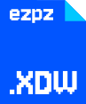
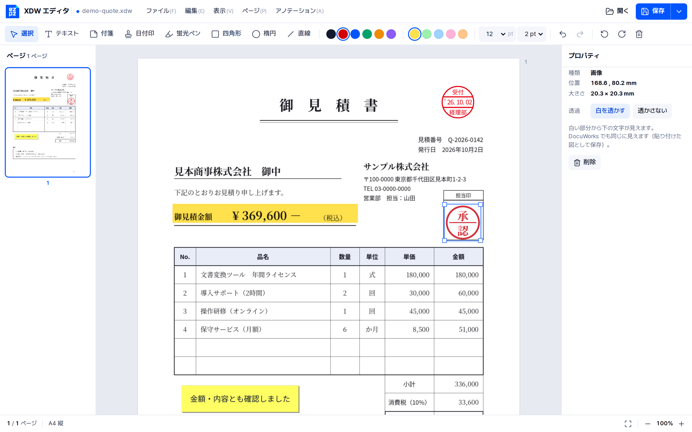

<p align="center">
  
</p>
<h1 align="center">EZPZ File XDW</h1>
<p align="center"><b>日本語</b> · <a href="README.en.md">English</a> · <a href="README.ko.md">한국어</a></p>
<p align="center">
  <a href="https://ezpzfile.com/ja/xdw-editor"></a>
</p>
<p align="center"><sub>デモ: <a href="https://ezpzfile.com/ja/xdw-editor">日本語</a> · <a href="https://ezpzfile.com/xdw-editor">English</a></sub></p>

**DocuWorks（`.xdw`）文書を、Mac・Linux・スマホ・ブラウザで開いて、アノテーションを付けて、そのまま保存。**
富士フイルム（旧富士ゼロックス）DocuWorks のファイルを扱うための、ゼロから作ったオープンソースの
エンジン・エディタ・ファイル形式仕様書です。ファイルは端末の外に送信されません。

状態: **v0.3。`.xdw` / `.xbd` に保存し直せるビューア + エディタ（開発者向けプレビュー）。**
富士フイルムビジネスイノベーション株式会社とは関係ありません。

[](https://ezpzfile.com/ja/xdw-editor)

<sub>見本の見積書に、日付印・蛍光ペン・付箋・透ける承認印を付けたところ。DocuWorks で開いても同じに見えます。</sub>

## できること

インターネットで公開されている DocuWorks ファイル 43 件（第 7・第 10 世代、`.xdw` と `.xbd`）で確認しています。

- 43 件すべてが開き、どのページも未知の描画レコードなしで描ける
- ページ: EMF・WMF の図形、DocuWorks ドライバ独自の圧縮パス・画像レコード、JPEG の画像断片、
  スキャン・回転ページ、アノテーション
- **`.xdw` への保存**: ファイル全体を書き直し、いま使っているデータだけを残す（削除したページや
  アノテーションはファイルに残らない）。署名のある文書だけは DocuWorks と同じ方式（末尾に 1 セグメントを追加）で
  保存し、署名した時点の内容を残す。保存したファイルは **DocuWorks Viewer Light** で開ける
- **新規作成**: 白紙の A4 1 ページから新しい DocuWorks 文書を作れる（DocuWorks 10 が作る文書と同じ形）。
  何も開いていないときに PDF や画像をドロップすると、それをページにした新しい文書になる
- アノテーション: **テキスト、付箋、日付印、蛍光ペン、四角形、楕円、直線、画像** の追加。移動・サイズ変更・
  内容の変更・削除（DocuWorks で付けた既存のアノテーションも移動・削除できる）。画像は **白い部分を透かして**
  下の文字を見せることもでき、DocuWorks でも同じに見える
- ページ内の **文字の選択・コピー**、**文書内の検索**（Ctrl+F）
- ページ: 左右に回転、削除、並べ替え（ページ一覧でドラッグ）。白紙ページ、画像（JPEG / PNG など）、
  別の `.xdw` / `.xbd` のページ、PDF のページ（画像として。PDF の文字も画像の下に残るので検索・コピーできる。
  pdf.js のために最初の 1 回だけネット接続が必要）の **挿入**
- **バインダー（`.xbd`）**: ページ一覧に文書ごとに表示。`.xdw` の追加、名前の変更、並べ替え、取り外し
- 書き出し: **PDF**（画面と同じ見た目、文字の検索・コピー可）、テキスト。印刷
- **覆われた文字を残さない**: 黒い四角形のアノテーションや不透明な画像で覆った文字は、取り出したテキストにも
  PDF の文字層にも入れない（見た目どおりに伏せた部分が、コピーや検索で戻らない）。エディタは保存のときに
  何文字を外したかを知らせる。残したいときは `includeHidden`
- **信頼できないファイルへの備え**: ファイルに書かれた大きさや個数をそのまま信じず、上限を超えるファイルは
  「too large or damaged（大きすぎるか壊れている）」として止める。ブラウザでは Web Worker の中で確かめてから開く
  （下の「信頼できないファイルを開く」）
- 元に戻す / やり直し

ファイル形式の解析結果（DocuWorks が確認する検査値、ドライバ独自の描画レコードなど）は
[docs/spec/XDW-FORMAT.md](docs/spec/XDW-FORMAT.md)（英語）にあります。

署名された文書は開け、署名を選ぶとその情報（電子印鑑か証明書か、署名モジュール、バージョン）が出ます。
編集すると署名が無効になるため、エディタがその旨を表示します。

パスワードや電子証明書で保護された文書は「保護された文書」と表示し、DocuWorks でセキュリティを解除して
から開くよう案内します（このエディタはパスワードを扱いません）。

まだできないこと: 署名の有効性の確認、新しい署名・パスワードを付けること。
詳しくは [計画](docs/PLAN.ja.md)
（[English](docs/PLAN.en.md)、[한국어](docs/PLAN.ko.md)）を参照。

## 信頼できないファイルを開く

`.xdw` は圧縮データの展開後の大きさ、画像の画素数、線の点の数などを自分で書いています。細工したファイルは
中身よりずっと大きな数を書けるので（数百バイトで「展開すると 4 GB」など）、エンジンはそれをそのまま信じず、
実際にあるデータと照らし合わせ、次の上限で止めます。既定値は本物の文書が必要とする量よりずっと上です
（公開サンプルのいちばん大きい値でも、どの上限の 3 割以下）。

| 上限 | 既定値 | 数えるもの |
|---|---|---|
| `maxBytes` | 768 MB | 1 回の読み込み、または 1 ページの描画で使う作業メモリ（展開したデータと画像の合計） |
| `maxExpand` | 256 MB | 圧縮データ 1 つを展開した大きさ |
| `maxRatio` | 1000 倍 | 圧縮データ 1 つの、展開後と保存時の大きさの比 |
| `maxPages` | 20,000 | 文書のページ数 |
| `maxImagePixels` | 1 億 | 画像 1 つの画素数 |
| `maxRecords` | 100 万 | 1 ページの描画レコード数 |
| `maxPoints` | 500 万 | 1 ページの線の点と文字の数 |

超えると「too large or damaged: …」のエラーになります。ほかのサービスに組み込むときは上限を下げ、Web Worker の中で
動かしてください。`web/worker/ezpzxdw-safe.js` がそれを行い、時間切れの Worker を止めます。ブラウザ用のエンジンは
最大 1 GiB のメモリしか使いません。

```js
import { readXdwSafely } from "./worker/ezpzxdw-safe.js";
const { result, hiddenChars } = await readXdwSafely(bytes, { want: "text", limits: { maxPages: 300 }, timeoutMs: 15000 });
// 直接: XdwDoc.openWith(bytes, '{"maxPages":300}')
```

Rust では `Document::open_with(bytes, &Limits { max_pages: 300, ..Default::default() })`。

覆われた文字: 各文字の枠（送り幅の内側、ベースラインから 0.7 em 上まで）が、あとから描かれた不透明な塗り（白も含む）か
不透明な画像に、クリップの範囲も含めて完全に入っていれば外します。蛍光ペン（掛け合わせ）、半透明の画像、線は覆いと
見なしません。文字と同じ描画の中の画像も覆いと見なしません（文字認識したスキャンや PDF から取り込んだページは、
文字を画像の下に置いているため）。残すには `XdwDoc.setIncludeHidden(true)`、Rust では `doc.include_hidden = true`、
コマンドでは `ezpzxdw text file.xdw --include-hidden`。
`.xdw` として保存したファイルには、DocuWorks と同じく覆われた文字もそのまま残ります。伏せた文書を渡すときは PDF で保存してください。

## エディタ

`web/dist/ezpzxdw-editor.html` は 1 ファイルで完結したエディタです。ダブルクリックで開き、`.xdw` を
ウィンドウにドロップして、アノテーションを付けて保存します（Ctrl+S → `.xdw`）。画面は DocuWorks Viewer に
合わせ（左にページ一覧、上にアノテーションの道具、右にプロパティ）、見た目は EZPZ File のデザインです。

キー: T テキスト、S 付箋、D 日付印、H 蛍光ペン、R 四角形、E 楕円、L 直線、Esc 選択、Delete 削除、
矢印（Shift で 1 cm）、Ctrl+Z / Ctrl+Y、Ctrl+S、Ctrl+Shift+S（PDF・テキストで保存）、Ctrl+P、Ctrl+F（検索）。
開いている文書に PDF や画像をドロップすると、ページとして挿入されます。何も開いていないときは、それで新しい文書を作ります。

画面の言葉は日本語と英語があります。英語版は `web/dist/ezpzxdw-editor.en.html` で、どちらのファイルも
`?lang=en` / `?lang=ja` で切り替えられます。ブラウザですぐ使うなら [ezpzfile.com/ja/xdw-editor](https://ezpzfile.com/ja/xdw-editor)。
ほかのサイトに載せるときは `web/dist/ezpzxdw-editor.embed.html` に `web/pkg/` の `.wasm` の URL を入れて使います。
同じサイトのページの枠（iframe）の中で開くと、`web/editor/host.js` の決まりでそのページとやり取りします。

## 本物の DocuWorks で確認

`tools/dwview` は富士フイルムの無料ビューア DocuWorks Viewer Light を Wine で動かし、ファイルが開けるかを
画面写真つきで報告します。`tools/dwapi` は DocuWorks 10 本体（最新版）の API を呼び出し、
保存したファイルを DocuWorks 自身に読ませて（ページ、アノテーションとその設定）、ページを描かせます。
テスト用に保存したファイルはすべて一致し、描画にも成功しました（公開サンプル 38 件 + DocuWorks 10 のサンプル
5 件、すべての編集機能）。DocuWorks Desk の一覧にもページつきで表示されます。
ゼロから作った新規文書と、ファイル全体を書き直した保存も Viewer Light で開けることを確認しています
（公開サンプル 39 件を書き直したもの・編集して保存したもの、新規文書、ブラウザで保存したもの）。
結果は [experiments/results.md](experiments/results.md)（韓国語）にあります。

## 構成

```
engine/crates/ezpzxdw-core   読み込み、描画（EMF/WMF/DW → 表示リスト）、編集、保存、PDF
engine/crates/ezpzxdw-cli    `ezpzxdw` コマンド: info, tree, pages, render, text, edit, check …
engine/crates/ezpzxdw-wasm   ブラウザ用バインディング
web/                       エディタ（ビルド: web/build.sh → web/dist/ezpzxdw-editor.html）
web/worker/                信頼できないファイルを Web Worker で読む（ezpzxdw-safe.js）
docs/spec/XDW-FORMAT.md    ファイル形式（英語）
docs/PLAN.{ja,en,ko}.md    計画と進捗（日本語、English、한국어）
tools/dwview               DocuWorks Viewer Light を審判にする（Wine）
tools/dwapi                DocuWorks 10 本体を API 経由で審判にする（Wine）
tools/webshot              ブラウザなしでエディタを操作する（Playwright）
corpus/manifest.tsv        公開サンプルファイルの入手先（ファイル自体は含まない）
```

## ビルド

```
cd engine && cargo test                       # コーパスのテストは EZPZXDW_CORPUS=/path/to/samples を付ける
cargo run -p ezpzxdw-cli -- pages file.xdw
web/build.sh                                  # wasm32 ターゲットと wasm-bindgen-cli 0.2.129 が必要
```

## ライセンス

MIT ライセンス（[LICENSE](LICENSE)）。使用・改変・再配布・商用利用は自由です。コピーや改変版には、
著作権表示「Copyright (c) 2026 EZPZ File (https://ezpzfile.com)」とライセンス文をそのまま残してください。
サービスや製品で使うときに、どこかに「Powered by EZPZ File」と表示していただけるとうれしいです（任意）。
商標とサードパーティの素材については [NOTICE](NOTICE) を参照してください。
